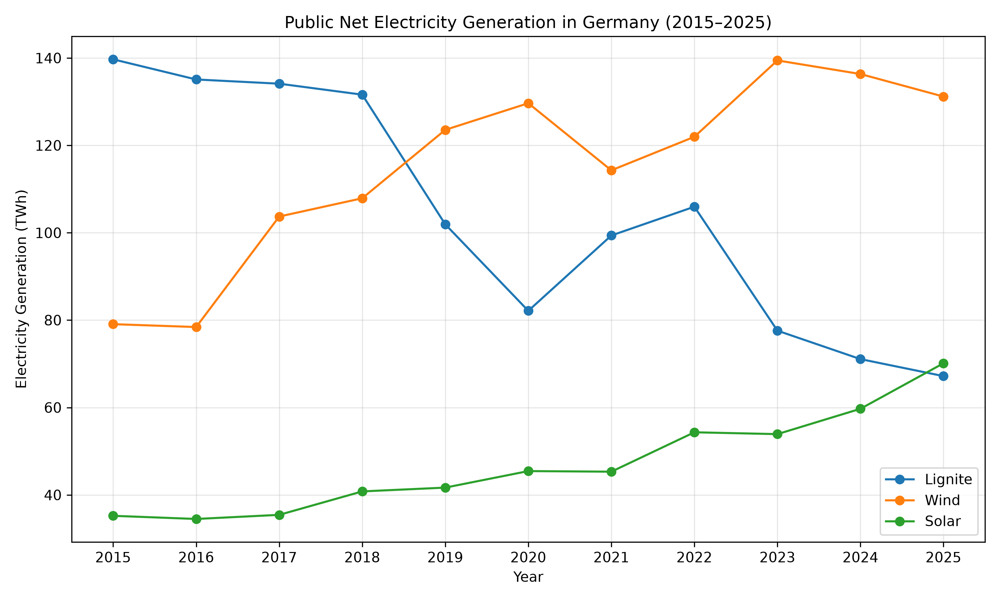
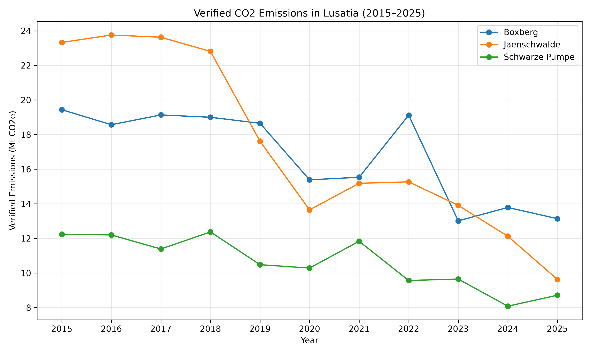
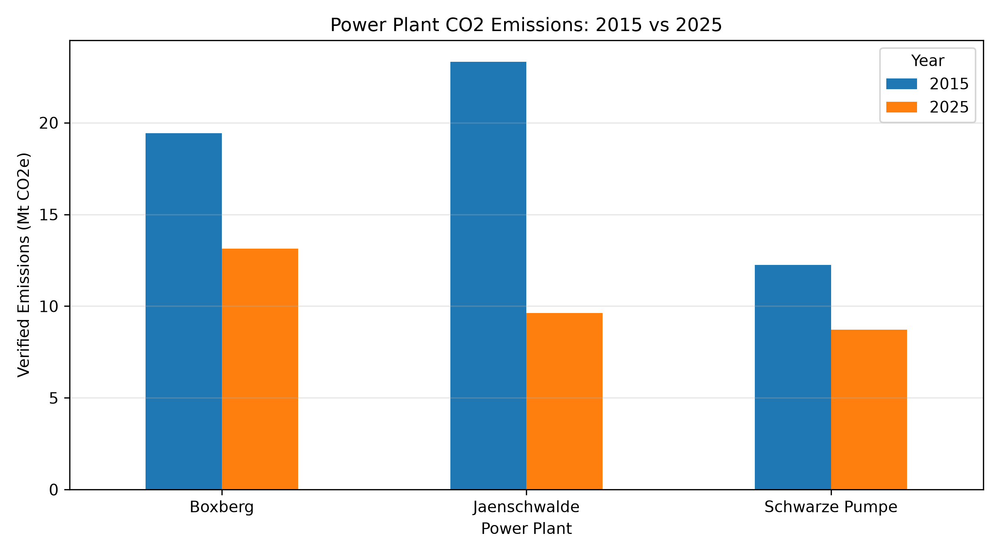

# CO₂ Emissions & Coal Phase-Out in Lusatia (2015–2025)

**Author:** Farhad Saeidi  
M.Sc. Environmental and Resource Management  
BTU Cottbus-Senftenberg, Germany

## Project Overview

This project investigates changes in Germany's public net electricity generation and verified CO₂ emissions from three lignite power plants in Lusatia (Jänschwalde, Boxberg, and Schwarze Pumpe) between 2015 and 2025.

**Important:** Electricity generation data cover all of Germany, while CO₂ emissions data cover only the three selected power plants in Lusatia.


## Data Sources

### Electricity Generation
- Source: Fraunhofer ISE Energy-Charts API
- URL: https://api.energy-charts.info/
- Period: 2015–2025
- Country: Germany
- Variables: Lignite, wind (onshore + offshore combined), and solar generation

### CO2 Emissions
- Source: European Commission — EU Emissions Trading System (EU ETS)
- URL: https://climate.ec.europa.eu/areas-action/carbon-markets/eu-emissions-trading-system-eu-ets/union-registry_en
- Dataset: Verified Emissions 2025 (contains annual verified emissions per installation for all years used)
- Period: 2015–2025
- Power plants: Boxberg, Jänschwalde, Schwarze Pumpe

## Methodology

1. Electricity generation data were retrieved using the Energy-Charts API.
2. Power values (MW) were converted into energy (MWh) using the time interval of each record.
3. Annual electricity generation was calculated in TWh.
4. Verified emissions were extracted from EU ETS installation-level records.
5. Emissions from Boxberg Werk III and Werk IV were combined.
6. Percentage changes between 2015 and 2025 were calculated.
7. Trends were visualized using Matplotlib.

## Results and Visualizations

### 1. Electricity Generation Trends (2015–2025)



### 2. Verified CO2 Emissions in Lusatia



### 3. Power Plant Emissions Comparison (2015 vs 2025)




## Key Findings (2015–2025)

| Indicator | 2015 | 2025 | Change |
|---|---:|---:|---:|
| Lignite generation (Germany) | 139.69 TWh | 67.18 TWh | -51.90% |
| Wind generation (Germany) | 79.07 TWh | 131.17 TWh | +65.88% |
| Solar generation (Germany) | 35.21 TWh | 70.12 TWh | +99.16% |
| CO₂ emissions (3 Lusatian plants) | 55.01 Mt | 31.49 Mt | -42.76% |


Notably, emissions from the three Lusatian plants (−42.8%) declined less sharply than national lignite generation (−51.9%).
National lignite electricity generation decreased substantially between 2015 and 2025, while wind and solar generation increased. Verified emissions from the three selected Lusatian power plants also declined, although the two datasets represent different geographical scopes.


## Limitations

- The 2015 electricity generation dataset is missing the first hour of the year.
- Changes in CO₂ emissions cannot be attributed solely to coal phase-out policies. Electricity demand, fuel prices, carbon prices, and other factors may also influence emissions.
- National electricity generation and plant-level emissions represent different geographical and operational scopes and should not be directly equated.
- Plant-level CO₂ intensity was not calculated because matching electricity generation data were unavailable. Combined heat and power production would also require appropriate emissions allocation.


## Repository Structure

- `src/` – Python scripts for data collection and analysis
- `data/raw/` – Original datasets (excluded from Git)
- `data/processed/` – Processed datasets and annual summaries
- `figures/` – Generated charts and visualizations
- `README.md` – Project documentation
- `requirements.txt` – Required Python libraries
- `.gitignore` – Files excluded from version control


## How to Run

### 1. Install Dependencies

Install the required Python packages:

```bash
python -m pip install -r requirements.txt
```

### 2. Run Electricity Generation Analysis

```bash
python src/fetch_energy_data.py
python src/analyze_generation.py
```

### 3. Run CO₂ Emissions Analysis

Download the "Verified Emissions 2025" Excel dataset from the European Commission's Union Registry:

https://climate.ec.europa.eu/areas-action/carbon-markets/eu-emissions-trading-system-eu-ets/union-registry_en

Create the folder `data/raw/eu_ets/` and place the downloaded Excel file inside it.

The original dataset is not included in this repository.

Then run:

```bash
python src/analyze_ets.py
```

### 4. Outputs

- Processed datasets are saved in `data/processed/`.
- Generated charts are saved in `figures/`.
